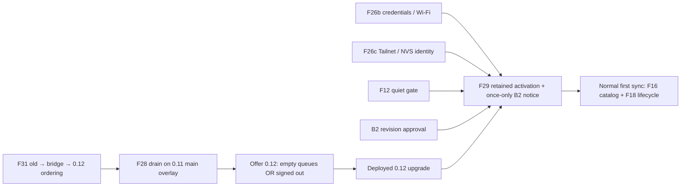

# BookSync 0.12 firmware plan

27 November 2026. Implementation authorized by the maintainer; Home revision 16 is
approved. Firmware B1–B5 mockups were approved on 27 Nov 2026 with the touch
keyboard change recorded in [SCREENS.md](SCREENS.md). The revised slim B2
upgrade notice is **APPROVED (2026-11-27)**; all other gallery groups retain their approval. This plan schedules work,
not a release or permission to invent screens.
Android 0.12 remains the semantic reference. X4 Pro, X4 Classic and X3/C3 X4 ship
the same Library, durable state and widget meanings; X3 draws bounded text views.

The source is `Fledgewing/booksync-firmware`, seeded from CrossInk stable v2.0.0
(`2cdd6117568c8877c3180d5fac8d5b20e55d1ac7`), pinned by the integration repo's
`xteink/firmware` on `feature/0.12`. Repository creation, initial pin and BookSync integration repo's
six-build/size job belong to the existing repository worker. Do not duplicate that
work, apply the old overlay, adopt development wholesale or reconsider the base.
The reader, SDK, typography, publisher fonts, text darkness, ruled lines, screen
calibration, stats capture, highlight anchoring, sleep, storage hardening and
simulator are retained. Selected fixes retain provenance and notices.

Reference: [approved design](../booksync-home/DESIGN.md),
[gallery](../booksync-home/mockups.html), [prototype](../booksync-home/prototype.html),
[backend boundaries](../backend-independence.md),
[delivery semantics](../command-delivery.md), [version/bridge](../unified-version.md).
This supersedes the older Home design's incremental-overlay/base-switch sequence
only where the 27 November rewrite ruling does so. It does not widen UI approval.
No BookSync server, second backend, SQLite port or generic plugin runtime is required.

## Slim upgrade decision — 2026-11-27

Maintainer: “Go slim — don't bother with anything that should be synced to BookOrbit.
On upgrade from 0.11 explain what didn't sync over and how to get it back
(sync from BookOrbit, basically).”

Remove settings import (former F26a), reading-record imports (former F27a–d:
positions, annotations, stats and download IDs) and pending-queue imports (former
F28a–d). Keep F26b credentials/Wi-Fi and F26c Tailnet/NVS identity, already in flight.
BookSync settings start at defaults. CrossInk's native reader files on the SD card
stay untouched: books and CrossInk's own place in each book keep working because
the reader is unchanged. No legacy records or queues are deleted.

Before upgrading, F28 drains the 0.11 queues to BookOrbit in the last 0.11 Xteink
bridge. F31's legacy-bridge ordering already routes **old → bridge → 0.12**; the
bridge additionally gates the 0.12 offer on empty queues or no signed-in account.
On 0.12, the first sync re-pulls positions, annotations (including bookmarks), stats
and book matches from BookOrbit through the normal F18 lifecycle and F16 catalog.
Match-by-identity handles existing SD files without re-downloading where possible;
there is no separate legacy download-ID importer. Data absent from BookOrbit cannot
be restored by that sync; originals remain on the card. F29's once-only B2 notice
explains the retained items, defaults and “Sync from BookOrbit now” / “Later”.

## 1. Components and reuse

Paths below are in booksync-firmware unless prefixed `BookSync integration repo:`. Under
`src/booksync/`, interface means immutable values and intents, services means work
and policy, storage means durable local mechanics, reader means engine integration,
and system means hardware/runtime integration. Each implementation file gets one
owner. UI never receives adapter DTOs, credentials, mutable stores or job objects.

| Android 0.12 reference | Firmware component and owning directory | Selected reuse from BookSync integration repo (paths under `xteink/`) |
|---|---|---|
| `ko/library.lua`, `ko/library_services.lua` | `interface/Library.h`, `Models.h`, `Commands.h`, `Capabilities.h`; `services/Library.cpp` dispatches to workers | New typed facade; no old global service facade |
| `LibraryReadModel.kt`, `DeviceLibrary.kt` | `services/ReadModel.*`, `DeviceIndex.*`; `storage/ProjectionStore.*`, `Index.*` | `orbify/core/Mirror.{h,cpp}`, `BulkCatalog.{h,cpp}`, `CatalogCache.{h,cpp}` algorithms after neutralization; protocol cache translation stays in adapter |
| `PersonalReading.kt`, `DevicePersonalReading.kt`, `CatalogPersonalReading.kt`, reading/battery aggregators | `services/PersonalReading.*`, `ReadingStats.*`, `Battery.*`; providers expose neutral records with precedence/provenance | `orbify/core/BatteryStatsCore.{h,cpp}`, `orbify/BatteryStats.{h,cpp}`; native capture, not `BatteryStatsActivity.*` |
| `ServerAdapter.kt`, `ServerAdapters.kt`, `server/bookorbit/` | Worker-only `services/ServerAdapter.h`; concrete factory, credentials, protocol, normalization and protocol checkpoints in `server/bookorbit/` | Extract protocol portions of `orbify/CacheStore.cpp`, `Mirror.cpp`, `BulkCatalog.cpp`, `CatalogRefresh.inc`, `CatalogRefreshWalk.inc`, `CopyRefresh.cpp`, `FinishSync.cpp`, `OrbiSmartSync.cpp`; never link their old orchestration |
| `SyncOwner.kt`, `LifecycleQueue.kt` | `services/SyncOwner.*`, `PositionPolicy.*`; `storage/LifecycleJournal.*`, `PositionStore.*` | `orbify/core/OrbiSmart.{h,cpp}`, `OrbiSmartState.h`, `LocalFirst.{h,cpp}`, `FinishQueue.{h,cpp}`, `CopyQueue.{h,cpp}` policy/tests only; replace numeric backend identities with opaque scoped aliases outside adapter/import |
| Catalog/copy/download/cover workers | `services/CatalogJobs.*`, `CopyJobs.*`, `DownloadJobs.*`, `CoverJobs.*`; `storage/FilePublish.*` | `orbify/core/CopyCheck.{h,cpp}`, `BulkRefresh.h`, `RefreshPlan.h`, `orbify/RefreshJournal.h`; audit publication from `CacheStore.cpp`, `CopyRefresh.cpp`; do not copy their direct clients |
| Home host, registry, layout/editor and widgets | `ui/Home.*`, `WidgetHost.*`, `widgets/`, `Editor.*`; `services/Layout.*`, `storage/LayoutStore.*` | Shared layout schema/fixtures from BookSync integration repo; new renderer. `orbify/core/SeriesCard.{h,cpp}`, `EndPageLayout.{h,cpp}`, `StatusFormat.h` supply neutral geometry/formatting ideas only |
| `LibraryAccount.kt`, settings, device/storage services | `services/Account.*`, `Settings.*`, `Storage.*`; `storage/SettingsStore.*`; concrete auth stays in adapter | Map `orbify/Settings.{h,cpp}`, `SettingsPin.{h,cpp}`, `SleepSettings.{h,cpp}` values; do not import their activities/global routing |
| Delivery tickets, event mailbox, lifecycle queue | `interface/Delivery.h`; `services/Delivery.*`, `Events.*` | New in-process owner/epoch tickets; reuse semantic Android cases, not JNI/polling transport |
| Reader lifecycle, position, finish, in-book panels | `reader/Bridge.*`, `Capture.*`, `SettingsBridge.*`; approved panels under `ui/reader/` | `orbify/core/EndPagePlan.{h,cpp}`, `SleepPick.{h,cpp}`, `SleepLayout.{h,cpp}`, `NextCover.{h,cpp}` policy; extract `EndPage.cpp`, `SleepScreen.cpp` drawing/capture, remove transport |
| Worker/runtime, Reading gate, network leases | `system/Runtime.*`, `ReadingGate.*`, `NetworkLease.*`, `Memory.*`, `Diagnostics.*` | `orbify/core/ReadingQuiet.{h,cpp}`, `WifiHolds.h`, `WifiPolicy.h`, `SleepSyncDeadline.h`; `Wifi.{h,cpp}`, `HeapFloor.{h,cpp}`, `CrashRecord.{h,cpp}`, `RefreshRunner.{h,cpp}` constraints, not old reboot/breaker orchestration |
| Transport/system integration | `tailnet/`, `system/Transport.*` | Pinned MicroLink; `tailnet/shim/Tailnet.{h,cpp}`, `TailnetResolver.cpp`, `TailnetStacks.c`, `TailnetLwipLock.c`, `TailnetWifiMem.c`, `TailnetTlsMem.c`, `TailnetSysSwitches.h`, `ml_priority.c`, `TailnetLog.cpp`, `ml_config.h`, `tailnet_build.py`; audit every build edit against stable SDK |
| C3 network/display ownership | `system/NetworkPhase.*`, neutral lease API in `tailnet/` | Rewrite `tailnet/shim/TailnetNetPhase.h` and `tailnet/ui/TailnetNetPhase.cpp`: remove backend activity IDs/auth boots. Reuse framebuffer admission rules, never restart/park foreground reading |
| Signed updates/version/recovery | `system/Update.*`, `Feed.*`, `Version.*` | `orbify/OtaManifest.h`, `UpdateChannel.h`, `OtaReturn.{h,cpp}`, `core/UpdateSignature.{h,cpp}`, `Ed25519Verify.{h,cpp}`; `ServerTrust.{h,cpp}` and `ServerTrustNet.{h,cpp}` transport trust with protocol parts kept private |
| Legacy retirement/import | `import/Inventory.*`, `Credentials.*`, `Identity.*`, `Activation.*` | Read-only, versioned credentials/Wi-Fi import and Tailnet/NVS identity audit only; native SD files untouched; legacy queue drain stays in the integration repo’s 0.11 overlay |

All `.h/.cpp` pairs above are selected source references, not promises to copy them
unchanged. For example `CopyQueue` currently has numeric server IDs and drops damaged
parse lines: neither behavior becomes the new journal contract. Preserve unreadable
source bytes and report retained-import failures. `BookOrbitBackgroundSync.*`, old
Home/catalog/settings/sync activities, `Tailnet*Activity.*`, UI routing patches and
old global writers are excluded. Keep SPDX/license notices on extracted code.

CrossInk evidence at the stable SHA above (links pin the exact source):
[ActivityManager.cpp:1216](https://github.com/uxjulia/CrossInk/blob/2cdd6117568c8877c3180d5fac8d5b20e55d1ac7/src/activities/ActivityManager.cpp#L1216)
is the Home routing seam;
[BookReadingStats.h:9, 27, 40](https://github.com/uxjulia/CrossInk/blob/2cdd6117568c8877c3180d5fac8d5b20e55d1ac7/src/activities/reader/BookReadingStats.h#L9)
defines native capture and versioned backup persistence;
[PluginEventOutbox.h:6](https://github.com/uxjulia/CrossInk/blob/2cdd6117568c8877c3180d5fac8d5b20e55d1ac7/src/util/PluginEventOutbox.h#L6)
is best-effort and cannot replace the durable journal;
[partitions.csv:2–7](https://github.com/uxjulia/CrossInk/blob/2cdd6117568c8877c3180d5fac8d5b20e55d1ac7/partitions.csv#L2)
is the unchanged partition map. Native local saves continue; native network sync
and plugin upload paths cannot remain active alongside SyncOwner.

## 2. Guards first

Build `module-layers.json`, `tools/test/test-ui-boundary.py` and
`tools/test/test-server-boundary.py` in firmware before adding product behavior.
Use BookSync integration repo's `android/koreader/module-layers.json` and boundary tests as the model,
with C++ include/symbol enforcement rather than Lua bytecode inspection.

- Inventory every production translation unit/header, generated resource and bridge
  by role, including retained `src/`, `lib/`, build-generated inputs and `tailnet/`.
  New and stale entries fail. Retained reader/SDK roles have narrow declared edges;
  they are not a wildcard exemption for product code. Third-party code is pinned
  and isolated behind wrappers. Inventory changes require the dependency rationale.
- UI can include only public Library value/intent headers and enumerated graphics,
  input and pure formatting primitives. Interface headers expose no store/client
  handles. Reject direct and transitive store, HTTP/TLS, filesystem, scanner, native
  settings singleton, private job, adapter and raw reader-service access. Compile
  a UI-only target without private include paths; inspect dependency/link symbols
  to catch aliases, forward declarations and hidden helper calls.
- Scan identifiers and string literals, stripping comments correctly: backend
  classes, routes, auth fields, wire keys, cache interpretation and legacy calls
  belong only to `server/bookorbit/` and read-only `import/`. No suppression comments,
  line baselines, per-file skips or composition-root protocol exemption. Adapter
  factory wiring is inside the adapter and exports a neutral factory symbol;
  `system/Bootstrap.*` uses that symbol without naming a vendor. Upstream attribution
  is resource prose, never a code escape. Generic OTA/Tailnet transport is separately
  typed and cannot issue library writes.
- All library network writes require SyncOwner's serial worker token; only adapters
  serialize them. Importers have no transport linkage. Link guards reject retired
  native sync/upload entry points. A toy adapter with opaque nonnumeric keys and
  different fixtures must pass the same Library/service tests.
- Guard every unsolicited show, navigation, notification, reboot, display parking
  and update-install path with ReadingGate. User-opened panels, end-of-book and the
  approved one-draw position-consent popup are explicit cases. No worker presents
  directly. Render tests fail on any network, parsing, scan or write during paint.
- Test the guards themselves with forbidden includes, transitive includes, aliases,
  mixed-case/escaped strings, generated resources, new files and hidden legacy
  writers. Run all build profiles: a disabled macro must not conceal a violation.

## 3. Ordered slices

Each row is a review unit of roughly half to one worker-day, including its tests.
Rows containing **each** expand into separate slices for each named item; do not
bundle them into a multi-day PR. If extraction proves larger, split capture,
policy, persistence or presentation before starting, keeping the listed acceptance
case. IDs ending in a suffix share a template, not a single implementation task.
All files below are proposed, relative to `src/booksync/` unless stated otherwise.

`H` means host unit/fault tests compiling production code; `S` means a scenario in
all three simulator profiles using synthetic SD/NVS and fake transport. Each row
adds both listed cases to `test/host/` and `test/simulator/`. Existing BookSync integration repo host/e2e
fixtures are ported, not selectors for removed activities. Never retry a failing
scenario into green. CI/build-only rows use a harness/boot smoke scenario.

Size entries are **unmeasured application-image delta estimates per device**, in
KiB (S3 / C3 when different), not reservations or claimed savings. `0` is tooling
only. Report actual `.bin`, map and static-RAM deltas per slice; report runtime
internal heap, largest block, stack high-water and bounded allocation peaks in
simulators where representable. Simulator heap is not hardware acceptance.
The hard gate is `6,553,600 - actual application .bin >= 131,072` on every device.
Never change partitions or quietly drop a feature to pass. Early full-link gates
include Tailnet/TLS/import code even before UI is complete.

| ID | Goal; files | Depends on; parallel work | H proof; S proof | Estimated KiB |
|---|---|---|---|---:|
| F01 | Role inventory, public Library/adapter stubs, guard rejection fixtures; `interface/*.h`, root inventory, `tools/test/*boundary*` | Repo exists; parallel F02/F03, first integration prerequisite | Bad include/string/alias fixtures fail; stub offline boot | 0–4 |
| F02 | BookSync-only firmware CI and six-profile harness; `.github/workflows/check.yml`, `tools/ci/*`, `test/simulator/` | Repo exists; parallel F01/F03; coordinate existing BookSync integration repo CI worker | Size parser pass/fail/missing artifact; all profiles boot pinned baseline | 0 |
| F03 | Synthetic legacy SD/NVS inventory and preserved-reader baseline; `test/fixtures/legacy/`, `test/host/reader_baseline*` | Repo exists; parallel F01/F02; read-only fixture work | Checksums/format inventory; EPUB fonts, anchors, stats, sleep/storage smoke | 0 |
| F04 | Route boot/Home to owned shell; remove native Home/catalog/theme entry graph; `ui/Home.*`, `system/Bootstrap.*`, `src/main.cpp`, ActivityManager/build filters | F01/F02; parallel F05/F06 | Forbidden product symbols absent from map; offline Home/open/Back | Negative, measure |
| F05 | Disable all native network writers and product sync/settings entry routes, retain local capture and hardware primitives; retained `src/` bridges | F01/F03; parallel F04/F06 | No upload/sync symbols/callers; reader session saves with zero requests | Negative, measure |
| F06 | Atomic SD publication primitive; `storage/FilePublish.*` | F01; parallel F04/F05 | Cut each write/sync/rename, full/read-only card; restart selects complete file | 2–6 |
| F07 | Versioned journal envelope, capacity and recovery; `storage/LifecycleJournal.*` | F06 | Torn tail/checksum/unknown version, no unacked eviction; offline enqueue/restart | 4–10 |
| F08 | Scoped identities/aliases and raw source locators; `storage/Identity.*`, `reader/Locator.*` | F03/F06; parallel F07 | Edition/path collision, account isolation; reopen reflowed book at native anchor | 2–6 |
| F09 | Native open/turn/close capture seam; `reader/Bridge.*`, `Capture.*` | F05/F07/F08 | Bounded captured events durable before delivery; read/close/reboot offline | 2–6 |
| F10 | Tailnet core/NVS/DNS port; `tailnet/shim/*`, MicroLink pin/build glue | F01/F02/F03; parallel F06–F09 | Existing lock/resolver tests, identical NVS keys/device identity; reconnect synthetic pairing | 40–140 |
| F11 | Transport admission, internal stacks, C3 display lease; `system/NetworkPhase.*`, `Memory.*`, neutral `tailnet/` API | F04/F05/F10 | No PSRAM flash/NVS stack, allocation failure releases lease; C3 refusal while reading, safe Home reconnect | 4–12 |
| F12 | Quiet presentation and delivery tickets; `system/ReadingGate.*`, `services/Delivery.*` | F01/F04; parallel F07–F11 | Once-only, A→B→A, late-ready/deadline, retirement leaves job; close/account switch never repaints | 3–8 |
| F13 | Bounded local index and snapshot publication; `services/DeviceIndex.*`, `ReadModel.*`, `storage/Index.*` | F06/F08/F09/F12 | 10k books, bounded page/batch, no paint I/O; first offline page/open without scan on paint | 5–14 / 4–10 |
| F14 | Early reader/Tailnet/journal size gate; `tools/ci/size.*`, simulator metrics | F04–F13 | All three real images pass margin, maps prove removed writers; offline read→capture→restart plus network admission | 0 |
| F15 | Account epochs, credential capture and adapter auth normalization; `services/Account.*`, `server/bookorbit/Auth.*` | F08/F10/F12/F14 | Legacy sync login is not web password, secret clearing, capability errors; sign-in/out worker flow with fake auth | 5–14 |
| F16 | Streaming adapter catalog/manifest translation; `server/bookorbit/Catalog.*` | F13/F15; parallel F17 | Malformed/oversized/partial/permission-lost responses; bounded 10k ingest and restart | 6–18 |
| F17 | Single owner activation and phase checkpoints with toy adapter; `services/SyncOwner.*`, journal extensions | F07/F09/F12/F14; parallel F15/F16 | Reject second owner, uncertain ack and retry; offline queue survives owner transition | 3–8 |
| F18a–e | **Each** lifecycle operation within its phase: match, stats, annotations (including bookmarks), state, progress; `server/bookorbit/Lifecycle<Phase>.*` | F15/F17; a first, b/c/d parallel after a, e after b/c/d | Per-phase crash before/after remote commit, checkpoint restart and dedup; per-phase timeout/restart/reconciliation | 2–6 each |
| F19 | Position ahead/behind/reset/override/decline policy; `services/PositionPolicy.*`, `storage/PositionStore.*` | F08/F17/F18e; parallel F20 | Shared BookSync position sync cases, stale answer token, edition conflict; same-book late consent after caller timeout, one draw | 3–8 |
| F20 | Finish/status/rating intent journal and Undo; `services/Finish.*` | F17/F18d/F18e; parallel F19 | Position precedes finish/status; unknown write result retained; offline finish/restart/Undo | 3–8 |
| F21 | Catalog generation commit and refresh leases; `services/CatalogJobs.*`, `storage/ProjectionStore.*` | F11/F13/F16 | Interrupted generation never replaces good data, account isolation; cancel/coalesce/late callback on Home | 4–12 |
| F22 | Filters/facets/counts/series/grouping projections; `services/Queries.*` | F21; parallel F23 | Scoped lists, secondary series, unsupported predicates; offline search/filter/paging | 4–12 |
| F23 | Verified resumable download to same SD path; `services/DownloadJobs.*`, `storage/FilePublish.*` | F16/F21; parallel F22 | Wrong digest/edition, no space, cancel, power cut; download/restart/open only if originating view lives | 5–14 |
| F24 | Copy replacement and sidecar preservation; `services/CopyJobs.*` | F08/F18a/F23 | Current/old/ambiguous copies, atomic rollback; updated EPUB retains reading/annotation state | 3–8 |
| F25 | Revision/account-scoped cover references; `services/CoverJobs.*` | F12/F21/F23; parallel F24 | Bounded decode/input, cache invalidation, retired ticket; post-paint acquisition, no late redraw | 3–8 / 1–4 |
| F26b | Retained credentials/Wi-Fi import (already in flight); `import/Credentials.*` | F03/F06/F08/F15; after F14; parallel F26c; credentials stay private | Old/unknown/corrupt formats retained, secrets never exposed; two boots preserve sign-in/Wi-Fi | 2–8 |
| F26c | Tailnet/NVS identity audit (already in flight); `import/Identity.*` | F03/F06/F08/F10; after F14; parallel F26b | Identical NVS keys, no key rederivation; two boots preserve pairing/device identity | 2–8 |
| F28 | **0.11 bridge drain**: last 0.11 Xteink update sends every pending progress, stats, annotations/bookmarks and finish/state queue item to BookOrbit; offers 0.12 only with empty queues or no signed-in account; nothing deleted. Files in **BookSync integration repo: `xteink/` overlay on `main`**, not owned firmware | Legacy queues/writers and F31 old→bridge→0.12 ordering; independent of 0.12 import implementation; release later through normal test/device/release flow, never by this docs change | Per-queue failures/unknown outcomes retain pending items; restart/offline drain, signed-out exception preserves queues, no offer while any signed-in queue is pending | 0 on 0.12; 2–8 on 0.11 bridge |
| F29 | Activate retained credentials/Wi-Fi/Tailnet imports only and once-only upgrade notice; `import/Activation.*`, `system/Bootstrap.*`; leave native reader SD files untouched | F26b/F26c/F05/F12; revised B2 notice APPROVED (2026-11-27); F28 bridge precedes deployed upgrade; sync action uses F16/F18 | Cut every retained-import/activation/notice checkpoint; repeated boots preserve sign-in/pairing and native SD bytes, no duplicate notice; Now starts normal sync, Later keeps offline reading available | 3–8 |
| F30 | Signed OTA/feed parser and trust port; `system/Feed.*`, `UpdateVerify.*` | F02/F10/F14; parallel imports | Existing signature/root/withdrawal/redirect/chunk/reset cases; fake feed rejects corrupt/wrong-device app | 8–24 |
| F31 | Unified version/bridge/source identity; `system/Version.*`, `UpdatePick.*`, packaging tests | F30 | All three asset stems, stable/preview/RC/test and legacy bridge ordering; old→bridge→0.12 simulated install choice | 2–6 |
| F32 | Install/return admission and diagnostics; `system/Update.*`, `Diagnostics.*` | F11/F12/F29/F31 | Wrong board/map, incomplete image, no install while reading; deferred fake OTA return/recovery | 3–8 |
| F33 | Shared layout persistence/validation; `services/Layout.*`, `storage/LayoutStore.*` | F06/F12/F13/F14; parallel adapter/import work | Schema/unknown widget retention, power cut, per-device override; bad layout falls back without deleting it | 3–8 |
| F34 | Widget host and starter widgets; `ui/WidgetHost.*`, `widgets/{Continue,Shelf,Browse}.*` | F04/F13/F33 | One batch/visible page, independent errors/budgets; approved offline Home in touch/buttons/text | 6–14 / 4–10 |
| F35a–c | **Each** editor increment: add/remove/reset; move/resize/focus; page create/name/reorder; `ui/Editor<Part>.*` | F34; a then b then c; parallel services | Atomic edits, focus/geometry invariants; Pro touch, Classic buttons, X3 approved Settings list equivalents | 2–7 each / 1–3 each |
| F36a–c | **Each** approved catalog surface: Library/lists; detail/actions; series/download-next; `ui/<Surface>.*` | F22/F23/F25/F34; parallel surfaces | Neutral snapshot/action tests; approved offline/back/download/error scenes in each profile | 3–9 each / 2–5 each |
| F37a–c | **Each** account surface: server/account; independent sync/OPDS logins; sign-out/origin confirmation; `ui/account/<Surface>.*` | F12/F15/F29/F34; a then b then c | Capabilities and account epochs; approved manual/phone sign-in states, closed form never repaints | 2–6 each |
| F38k | **Each** approved Settings control, separate service then UI slice; `services/Settings<Kind>.*`, `reader/SettingsBridge.*`, `ui/settings/<Kind>.*` | F29/F34; independent families; B4 approved; control dependencies apply | Enum mapping/roundtrip/Undo; approved reading/Custom, sync/power, Library/storage, About/channel scenes | 1–3 per half |
| F39 | Personal provider precedence and stats coverage/watermarks; `services/PersonalReading.*`, `ReadingStats.*` | F09/F18b/F21; parallel UI | No aggregate/session double count, deterministic picks, absent versus zero; offline/local/account coverage | 3–10 |
| F40w | **Each** remaining widget, one provider projection then one renderer slice; `services/widgets/<Id>.*`, `ui/widgets/<Id>.*` | F34/F39, relevant adapter/system capability; parallel widget IDs | Independent known/empty/off/unsupported/stale/oversize fixture; approved widget scene and X3 text action | 1–4 per half |
| F41r | **Each** approved reader panel, separate intent seam then presentation slice; `reader/<Panel>.*`, `ui/reader/<Panel>.*` | F09/F12/F19/F20/F22/F38k; parallel panel IDs | Engine invocation/locator preserved, capability and cancel; approved panel/Back/read-position scenario | 1–5 per half |
| F42 | Cached sleep presentation and bounded sleep/wake drain; `services/Sleep.*`, `ui/Sleep.*`, reader sleep seam | F11/F12/F19/F29/F34 | Deadline/capture before sleep, cached-only draw, wake ownership; sleep/reboot/resume no network during paint | 3–8 |
| F43 | Device/control projections and diagnostics recovery; `services/Device.*`, `Battery.*`, `system/Diagnostics.*` | F11/F12/F29/F38k; parallel F40/F41; B1/B4/B5 approved; slice dependencies apply | Hardware capability truth, crash dedup, storage ownership; approved battery/light/rotate actions, no unsolicited overlay | 3–10 |
| R1 | **APPROVED (2026-11-27):** bedtime and Rest your eyes on all three profiles; [design](../reminders.md), [every approved state](../reminders-mockups.html). Separate small PRs: `services/Reminders` + `storage/RemindersStore` and Library operations/events; clock-seam provenance; narrowly typed ReadingGate exception + runtime presenter (gate docs/guard tests together); Settings → Reminders, editors and sheets. | F06/F12/F33 and native reader lifecycle/input/clock seams; Android worker in parallel; UI uses Library only, sole sync writer and retained reader behavior unchanged | H: scheduling/missed/snooze, offset/leap-day and DST-equivalent changes, idle reset/arbitration, claims/responses and every storage-recovery boundary; S: approved scenes on Pro/Classic/X3, no paint I/O or unsolicited non-reminder draw; enforce design memory/event/store budgets and 131,072-byte reserve on each real image | Measure each PR; no size claim |
| F44 | Full cutover/fault/reader regression gate; `test/host/`, `test/simulator/`, `tools/ci/*` | All applicable 0.12 slices, including essential B1–B5 presentations and all six F46 live-integration increments; F28 bridge drain/offer evidence for deployed upgrade | Lost power/full SD/unknown delivery/account isolation; six builds, three full scenarios, maps/heap/time reports | 0 |
| F45 | Maintainer device acceptance gate; BookSync integration repo acceptance record and feature/roadmap evidence | F44; no parallel promotion | Passing host/simulator receipts supplied; maintainer alone checks devices and records acceptance | 0 |
| F46a | Live HTTP transport and default adapter registration behind Library; `server/bookorbit/`, neutral adapter contracts; selected service + retained credentials only, bounded response streaming, no paint I/O | F15/F16/F29/F37a; first of six sequential firmware PRs | H: credential isolation/removal, malformed/truncated/bounded framing and auth expiry; S: admitted real HTTP catalog against existing `tools/e2e` server on Pro/Classic/X3, offline cached boot; three real builds and actual 128 KiB margin | Measure |
| F46b1 | Durable account/source-bound native captures and concrete match/stats evidence; `reader/Capture.*`, native evidence ports and private adapter scope/source storage; preserve unknown/unbound observations | F46a/F08/F09/F18a/F18b/F21/F22; merge after F46a | H: immutable captures, independent UUIDs, exact source revision, ambiguous edition/account isolation and capture/publication cuts; S: current native SD capture/restart on Pro/Classic/X3 without network or legacy-reading import; three real builds and margin | Measure |
| F46b2 | Concrete annotation workspace and state/progress evidence/application, plus retained native TLS trust evidence; private adapter/native worker seams, preserving native files and unknown locators | F46b1/F18c/F18d/F18e/F19/F20; merge after F46b1 | H: account/source-bound native application, full raw replies, idempotent publication and every cut; S: first sync/restart with existing SD files, no duplicate or lost annotations/stats/state on all profiles; three real builds and margin | Measure |
| F46c1 | Real bounded F18 phase transports and F19/F20 adapter operations; private wire mapping, streamed request/response bodies and explicit uncertain outcomes | F46b2/F18a–e; F19/F20 plug in through their interfaces when merged, otherwise explicitly registered-off | H: framing/body bounds, exact frozen reconciliation, auth expiry and unknown result retention; S: real phase endpoints against existing `tools/e2e` server on Pro/Classic/X3; three real builds and margin | Measure |
| F46c2 | Connect Library to the sole sync-owner worker; Wi-Fi-up, Home widget/upgrade Sync intents and bounded periodic cadence; ReadingGate and worker-only network | F46c1/F17/F29/F32; merge after F46c1 | H/S: first sync, offline, auth expiry, account switch and power cut mid-sync against existing `tools/e2e` server; all three simulator profiles including X3, no paint work or competing writer; report live flows and remaining F19/F20 work; three real builds and margin | Measure |
| F46d | Schedule F24 copy replacement at admitted non-reading sync opportunities through the existing download worker and journal; no second writer | F46c2/F24; sixth sequential firmware PR, precedes F44 | H: current/old/ambiguous copies, closed-book proof, failure/retry and atomic rollback; S: updated EPUB preserves native place/annotations through restart and account switch on Pro/Classic/X3; three real builds and margin | Measure |

F46 retains four goals across six review units: native evidence is split into
capture/proof and native application, and sync integration into phase transport
and runtime/triggers. Merge each firmware PR before starting the next. All
original F46 acceptance cases remain required; this split adds no screen or pin change.

F38k control groups (one slice per control per half): Reading/Custom; Sync/Wi-Fi/power policy; Library/storage; About/update
channel. Implement only controls whose device presentation is approved. Direct
hardware configuration follows the approved B1/B4 states below; additional
unillustrated states still need approval.

F40w X4 scope follows the installed Android 0.12 widget registry and renderers,
not the withdrawn 0.11-only filter. The [compact X4 proposal](F40w-widgets.md)
is **APPROVED (2026-11-28)** for all 30 types, every state and optional size:
smallest useful main views at 0.11 density, optional larger
views, and All (n) › at the top-right of headers. Canonical registry IDs:
`continue-reading`, `booklist`, `this-week`, `reading-streak`, `year-in-reading`, `when-you-read`, `reading-records`, `today`, `reading-goal`, `pages-read`, `monthly-reading`, `finish-forecast`, `battery`, `library`, `lists`, `recommended`, `discover`, `highlight`, `yearago`, `word`, `buddy`, `dust`, `achievements`, `sync-controls`, `reader-toggles`, `light`, `clock`, `moon`, `glyph`, `next-stop`.
Book list presets (including Also reading, Recently added, Want to read, Finished,
Pick back up, Up next, year-finished, Unopened and On device) share its renderer
but retain independent source/order/acceptance cases. Library source pickers and
Authors/Series/On-card links are not new widget IDs. Achievements and Battery stay
because Android installs them; Finish forecast remains separate. Word still needs
a bounded lookup-capture increment before its projection; any capture parser gets
its own host/simulator slice. Add neither a fake account goal nor zero unknown days.
Light is unavailable on hardware without it. X3 remains off for new widgets whose
text scenes are not approved; this X4 review grants no X3 approval. A four-cover
Discover projection must explicitly budget/test all four rows before its renderer.

F41r panels: top/bottom reading menu, quick settings/Custom, TOC, bookmarks,
highlights, go-to/scrub, bounded book search, book info/series link, end-of-book.
Keep the engine's native behavior and escape while adapting approved presentation.
If search needs a new incremental engine operation, split bounded scan, cancellation
and publication into separate tested slices before its UI; no full-book RAM index.
These template expansions are independent worker-day units, not a claim the whole
rewrite takes 45 days. Estimate again after F14; no schedule justifies data loss.

Parallel lanes after F14: adapter/lifecycle (F15–F25), read-only imports
(F26b/F26c as dependencies become ready), OTA (F30–F31), and host/layout
(F33–F35). F29 joins retained imports and the quiet notice; its sync action uses F16/F18.
F28 runs on main in the 0.11 overlay, before deployed cutover; F31 supplies the
old→bridge→0.12 ordering. There is no 0.12 legacy-reading/queue-import lane. UI joins proven services,
not provisional direct clients. Resource-sensitive builds serialize within one
checkout and use isolated PlatformIO package homes. This plan describes future
parallel assignments; it does not start additional workers.

Slim upgrade dependency graph (service implementation may precede UI approval;
bridge release/device evidence is required before a deployed upgrade):

Import estimates now cover two 2–8 KiB retained slices (4–16 KiB total),
rather than eleven 2–8/2–10 KiB import slices (22–96 KiB total). Nine import
slices are removed and one 0.11 bridge slice added: eight fewer half-to-one
worker-day units before expansion. F29 remains 3–8 KiB; the static notice is
included. These are planning estimates, not measured savings or device evidence.

F14 stops growth if a target misses the physical margin. Strip unreachable native
product code, bound buffers and review map deltas; do not remove retained reader
features, change the base or replace direct X3 with a server-only profile by default.
All platform capability changes update BookSync integration repo's four feature cells/reasons in their
implementation PRs. Until release, work stays in ROADMAP; this plan ships no feature.

## 4. CI and pin integration

The repository worker removes inherited workflows with Actions disabled. Once that
is verified, F02 adds a BookSync-only workflow and enables only the intended CI.
Trigger on PRs into firmware `main` and pushes to `main`; no tag, schedule, release,
feed publication or upstream update trigger. Require one aggregate check covering:

1. Complete role inventory, boundary guard self-tests, workflow supply-chain checks,
   host policy/storage/import/fault tests and retained reader tests.
2. Hardware builds `x4-pro`, `x4-classic`, `default` (C3); simulator builds
   `x4-pro-simulator`, `x4-classic-simulator`, `simulator-X3`. Build and run all three
   simulator scenario suites, including offline first paint and reading quietness.
3. Per-device actual application `.bin` bytes, free bytes in the 6,553,600-byte slot,
   static data/BSS/IRAM/RTC sections, map/symbol deltas and pinned input manifest.
   Fail below 131,072 free bytes, missing measurements or mismatched partitions.
   Reuse the repository worker's checked-in budget/parser and regression fixtures;
   move or mirror the same config into firmware with an equality check, never two
   independently maintained thresholds. Keep runtime allocation reports separate.
4. Upload test images/ELFs/maps, source-input receipts, host logs, simulator captures
   and size reports. Artifacts are not updater candidates and create no release.

Pin Actions by SHA, checkout with `persist-credentials: false`, use read-only
permissions, and keep build jobs free of signing secrets/write tokens. Pin SDK,
simulator and MicroLink commits/toolchain dependencies. Use synthetic credentials
and test signing fixtures only. Keep combined GPL source/notices/build provenance.

Merge firmware PRs only after its CI is green. BookSync integration repo then bumps the immutable
`xteink/firmware` pin in a separate PR into `feature/0.12`; its existing worker-owned
job rebuilds the six environments and checks the same budget, plus shared fixtures,
version/feed compatibility and release-input fingerprinting. Version and signing
trust still come from BookSync integration repo's release inputs; no independent firmware version clock.
Test identities must remain excluded from feeds. CrossInk provenance metadata is
not version precedence. Keep asset stems, partition map, signed feed trust and all
retained legacy bridges, including stable-channel reachability.

Neither repository publishes until the maintainer explicitly says so. F45 is a
mandatory acceptance record, not an automatic release trigger. Agents never touch
devices/serial ports; only the maintainer sideloads and checks typography, anchors,
reading stats, SD/NVS migration, Tailnet identity, sleep/wake, OTA and e-ink/input
behavior on every reader. Device evidence cannot be replaced by simulator success.

## 5. Firmware screen gates (B1–B5)

The maintainer approved the [firmware gallery](mockups.html) and
[screen/state inventory](SCREENS.md) on **27 Nov 2026** (PR #202), with one
change, verbatim: "On screen keyboard should always be on the bottom for touch".
B1/B3/B4/B5 retain approval; the slim B2 revision is **APPROVED (2026-11-27)**.
Retained service work may continue. Each approved UI slice may
proceed when its corresponding service, test and slice dependencies are satisfied.
The Q1–Q7 coordinator decisions are recorded in SCREENS.md.

Home revision 16 remains approved, including X3's text/button mode. The firmware
gallery adds the B1–B5 device, error and confirmation states. Record the exact
prototype scene/state for every implementation slice; additional unillustrated
states need approval rather than being invented. Touch on-screen keyboards always
dock at the bottom, with content and fields visible above; button views are unchanged.

| ID | Approved presentation coverage | Required service/test dependencies |
|---|---|---|
| B1 | Wi-Fi selection/password/join recovery; Tailnet pairing/status/route/logout/re-pair; C3 network wait/refusal/recovery | F10/F11 transport, NVS retention and leases; F12/F43 and fake-hardware tests |
| B2 | **APPROVED (2026-11-27):** once-only slim upgrade notice, retained Wi-Fi/sign-in/Tailscale pairing and native books/place, BookSync defaults, server restore with Sync from BookOrbit now / Later; existing queue/reset/downgrade views retained | F26b/F26c/F29 activation and notice checkpoint; F12 quiet gate; F16/F18 normal sync; F28 deployed bridge drain and F31 ordering; durable capacity policy |
| B3 | Firmware download/install/restart, trust/board rejection, interrupted update/recovery and compatible return controls | F30–F32 parser/trust/bridge, F29 retained-import activation proof and deferred-install tests |
| B4 | Calibration, ruled lines/fonts, hardware shortcuts/frontlight schedules, PIN/security, USB/SD ownership and dictionary/search recovery | F38k/F41r/F43 service seams, retained engine/settings/data and native escape |
| B5 | Persistent crash summary, local diagnostics export, recovery/reset confirmations, optional first-run and once-only Home upgrade news | F43 capture/dedup/read model; F29 for upgrade news; no automatic upload or presentation |

Approval does not waive durability, compatibility, resource or device acceptance.
Do not ship a cutover with essential configuration/recovery inaccessible. Implement
each approved screen/state as its own small UI slice on its tested service. F44
waits for essential B1–B5 surfaces and their tests; optional presentations may be
deferred without delaying core tests.

## 6. Remaining one-way doors

Repo/base, Library-only UI, sole writer, preserved reader, direct BookOrbit first,
X3 text parity, partitions/paths/NVS identity, trust/asset/bridge compatibility and
128 KiB margin are settled. No additional product decision blocks F01–F03.

Two durable-contract gates remain before F29 enables real outgoing delivery:

- Freeze canonical identities, edition/source-locator mapping, event/tombstone and
  dedup/ack semantics only after normal lifecycle round trips, ambiguous editions, cross-account
  tests and shared Android/firmware cases pass. Keep raw locators and unknown fields; native legacy files stay untouched. This does not freeze a server/export protocol or promise missing history.
- Review the retained-import/activation proof and recovery record before first
  0.12 outgoing delivery. F28 drains legacy work on 0.11; 0.12 never replays a
  legacy queue. Unknown deliveries reconcile; they are never invented
  acknowledgments. Originals/backups remain; deleting them is separate future work.
  An older app cannot undo remote writes or understand every new journal: no promise
  of bidirectional downgrade compatibility. New schema versions remain readable by
  the owned recovery tools before a writer uses them.

These are review gates for concrete tested contracts, not invitations to reopen the
settled architecture. License/provenance is preserved per extracted file. A future
support cut, repartition, changed trust root or service-required X3 would need a new
maintainer decision and is outside this plan.
