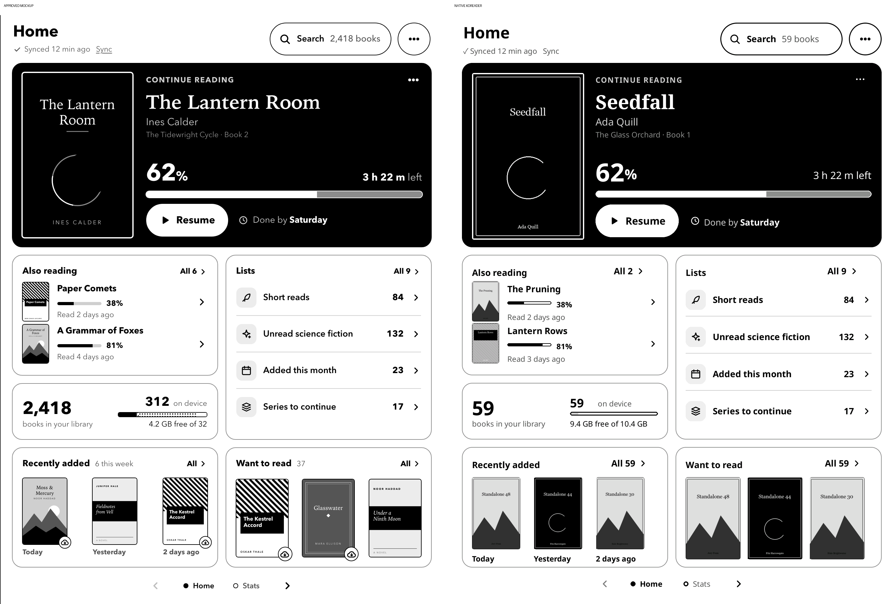
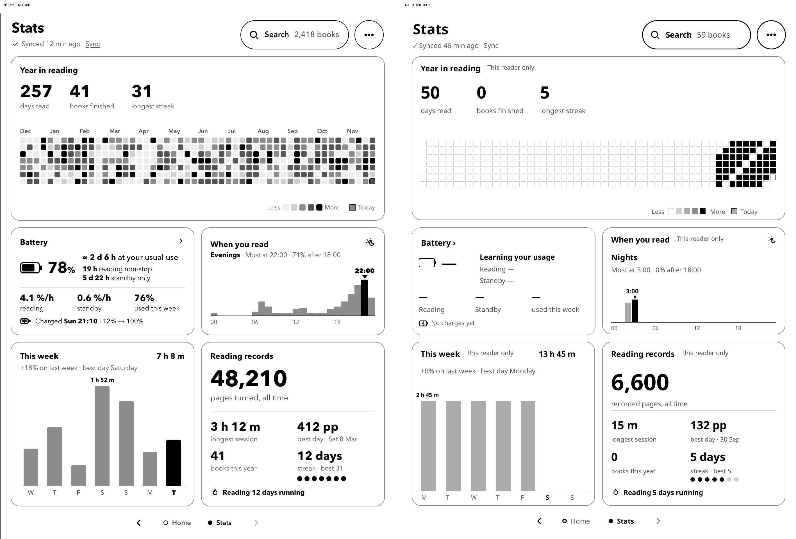
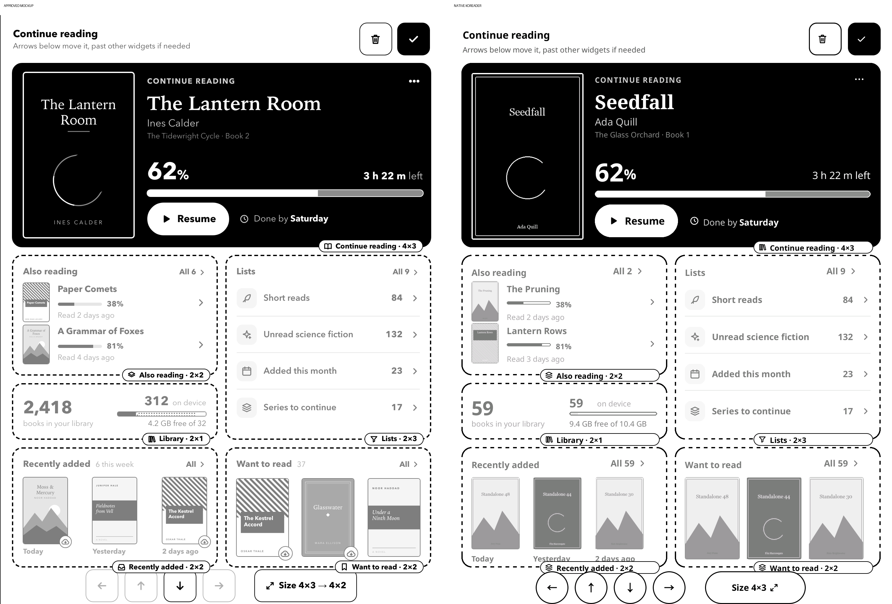
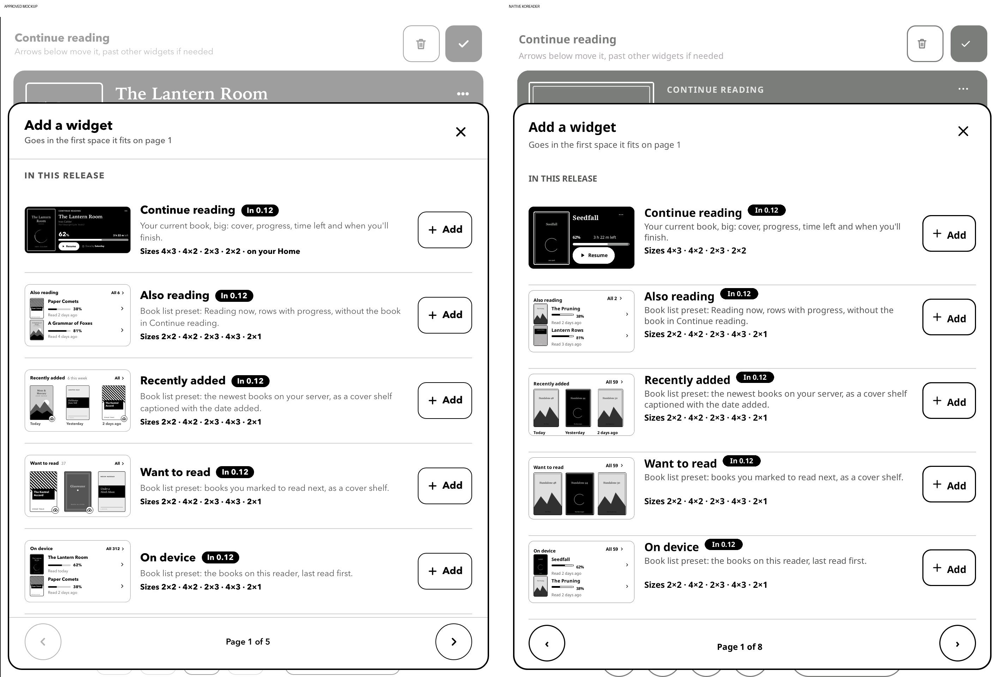
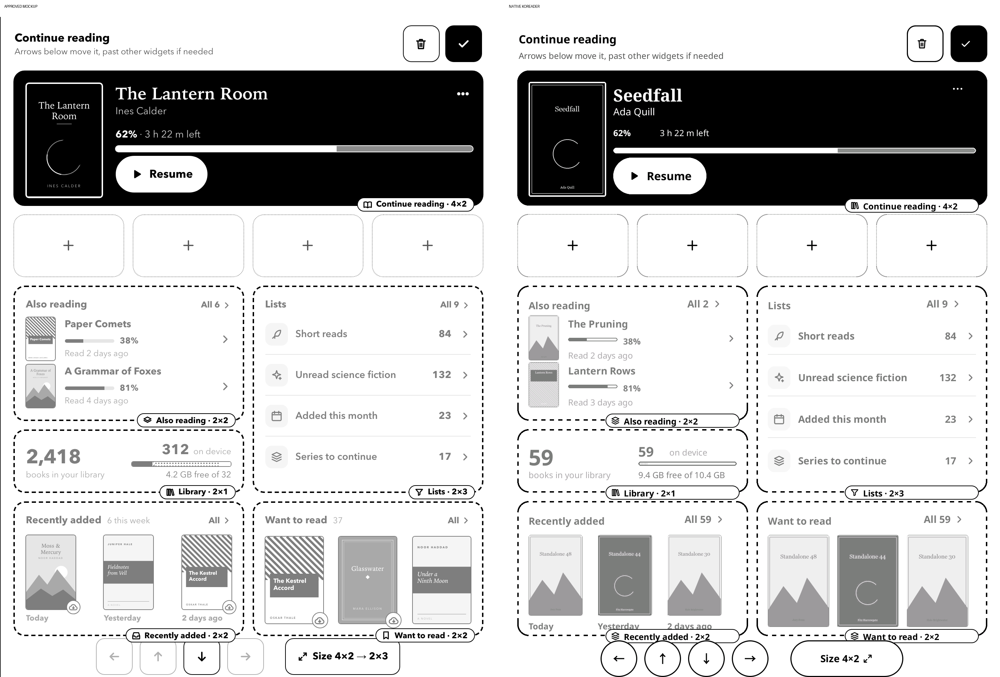
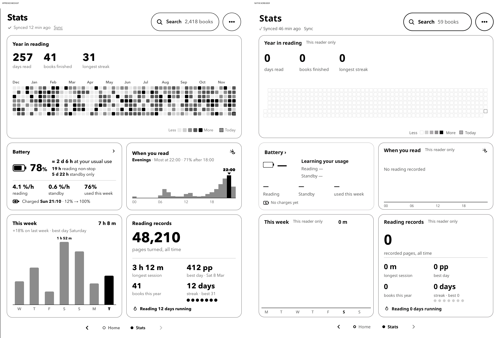
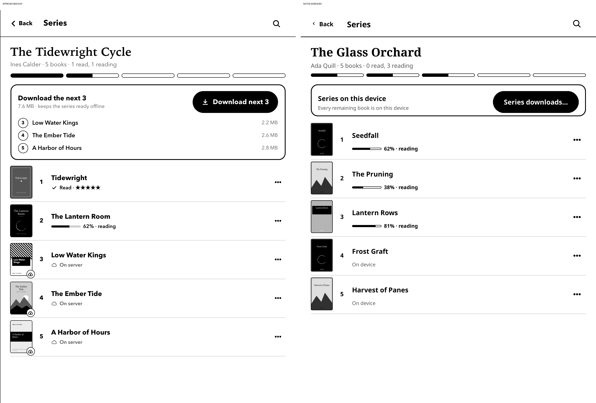
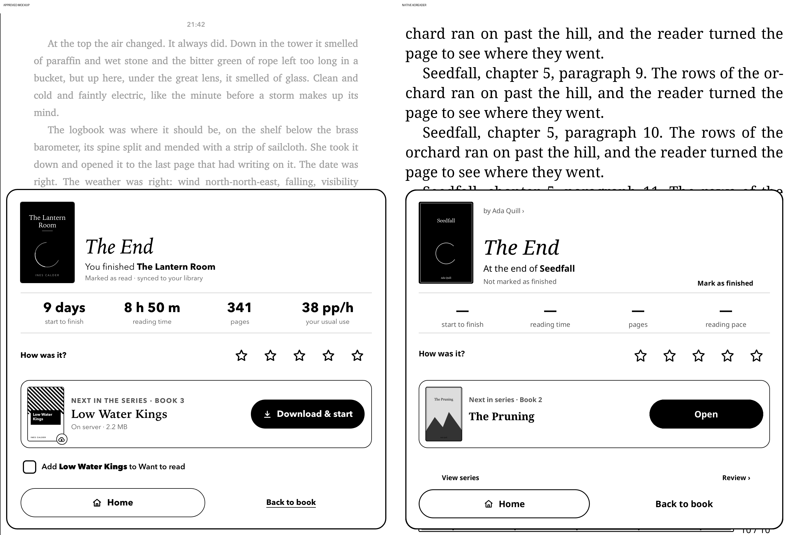
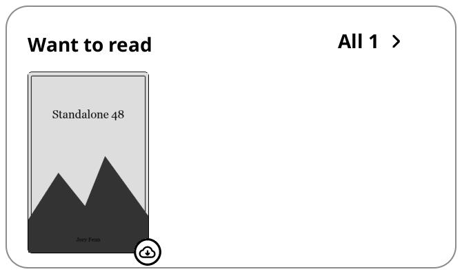

# V1 Home native verification

Approved mockup left, actual KOReader capture right. No image is resampled.
M8C emulator: 1404×1872, 300 dpi, KOReader v2026.07.1, opt-in fake ServerAdapter.
The fixture contains 59 synthetic books, raster covers, series, three saved reading
positions, finished-book metadata, recent dates and saved lists. No physical device
or external BookOrbit request is used. Setup requires Pillow for cover generation.

Fixture titles, cover artwork and counts differ; all 59 fixture books are on device, so no remote-download badges are expected.

X2 synthetic statistics DB: 50 days, 6,600 recorded page visits and real hourly/weekly aggregates. Values differ from the invented mockup; this dataset is concentrated at night. Battery deliberately remains unmeasured.

Cached native previews; selected hero and dimmed/dashed neighbours. Uses the fixture library rather than the mockup's invented books.

Five illustrated choices, release badges, descriptions, size spans and Add actions; no projection reads. Page count follows the installed widget registry.

The same native size callback is exercised; free cells and neighbours stay in place.

Same real renderers with an empty statistics DB: short unknown-value copy, no truncated labels. The approved populated mockup is retained on the left for shape/spacing comparison.

The local-series card contracts from 178 to 76 design pixels; no reserved rows for remote downloads. The approved remote-download state remains on the left.

No measured reading history yields an em dash for pace. Synthetic title, availability and finish status differ from the mockup.

Native cover specimen without a local file; the default fixture is fully on device.

## Validation

- Native `home_stats.py`: all 34 Stats/Battery sizes in both empty and seeded states;
  every admitted native TextWidget is checked with `isTruncated()` and for literal
  ellipses. The supplied X2 DB contains exactly 50 distinct history days.
- Native `home_details.py`: compact local-series card and unavailable finish pace.
- Native `ui_kit.py`: 15 component renders plus bold Search / muted regular count.
- Native `home.py`: default spans, ready views/covers, zero-query editor/picker,
  real move and next-fitting-size callbacks, saved layout persistence.
- Lua flows: 325 passed, 0 failed.
- Lua logic: 275 passed, 0 failed, plus 13 focused presentation assertions.
- KOReader source-symbol compatibility passed at pinned `9192014` (the optional
  koreader-base FFI static check was skipped); native FFI rendering ran on Android.
- Feature-matrix checks: 4 passed.
- External fixture APK assembled and `lintDebug` passed with strict Gradle
  dependency verification enabled.

The gallery is generated by `tools/e2e/android/home_gallery.py`. Native captures and
its JSON receipt come from `tools/e2e/android/home.py`; the capture tool rejects physical targets
through the existing Emulator guard. The capture tool resets its disposable layout
through the real layout save API, and restores defaults after persistence checks.

## Remaining differences

Noto Serif/Sans substitute for the proprietary mockup faces; native font hinting and
SVG rasterization differ. Book names, artwork, totals, available-cover state and
picker page count follow the synthetic fixture/installed registry. The supplied
50-day statistics DB concentrates sessions at night; charts and totals reflect
those real fixture rows rather than the mockup's invented distribution. Battery
has no measured charge/rate history, so its short empty state is intentional.
No truncated Stats/Battery labels remain in either tested state. This evidence
does not claim device acceptance or a release.
