# V3 native visual review

Approved reference left; native KOReader on the right. Captured on a dedicated Android 14 emulator at 1404×1872, 300 dpi, using the fake companion adapter and a synthetic 59-book library.

The `series-next-three` image is an additional bounded adapter-response specimen. Other captures use the companion projection. Choice sheets use the approved parent-sheet reference because dedicated picker crops are unavailable.

Noto replaces unavailable Avenir/Iowan fonts. Fixture titles, covers, counts, progress and device capacity differ. Unavailable per-book statistics are shown as dashes; unavailable byte sizes and Want-to-read writes are not invented. The existing undimmed backing-page contract is retained. Variable-sized grouped pages show the page number without guessing a page total.

## library

Five columns, three cover rows and centered page control. Synthetic titles, art and 59-book count differ from the 30-book reference.

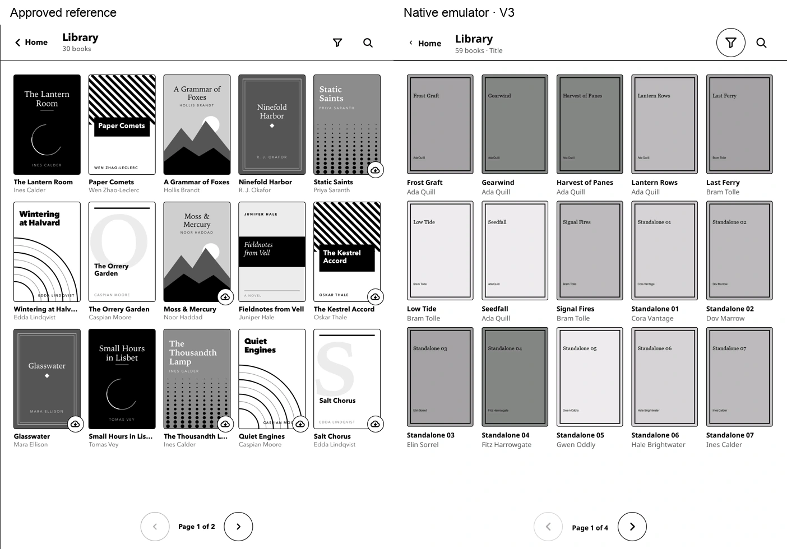

## library-page-2

Paging uses the displayed 15-book window; Back returns to the exact first key.

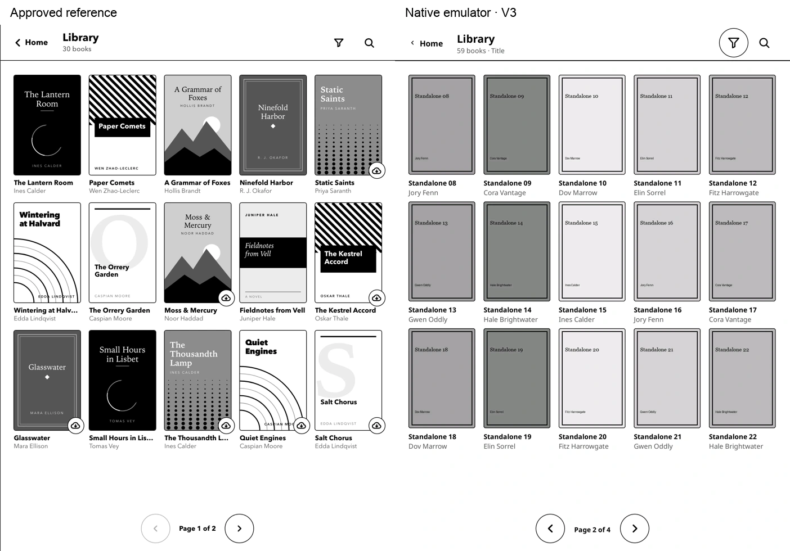

## filter

Full-height refinement sheet. Library/default values differ from the reference’s Recently added/Unread/On device selections.

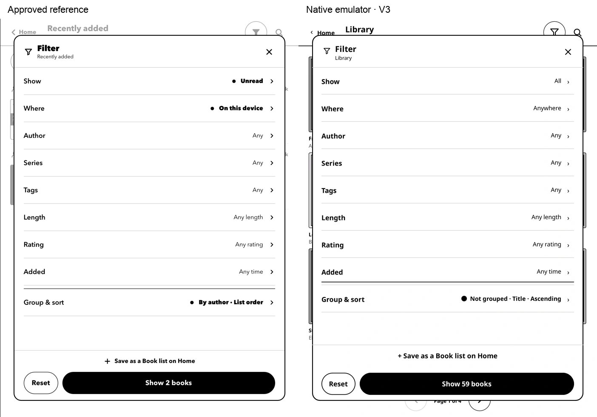

## filter-selected

Unread selection is retained, counted and applied. Other fixture selections differ.

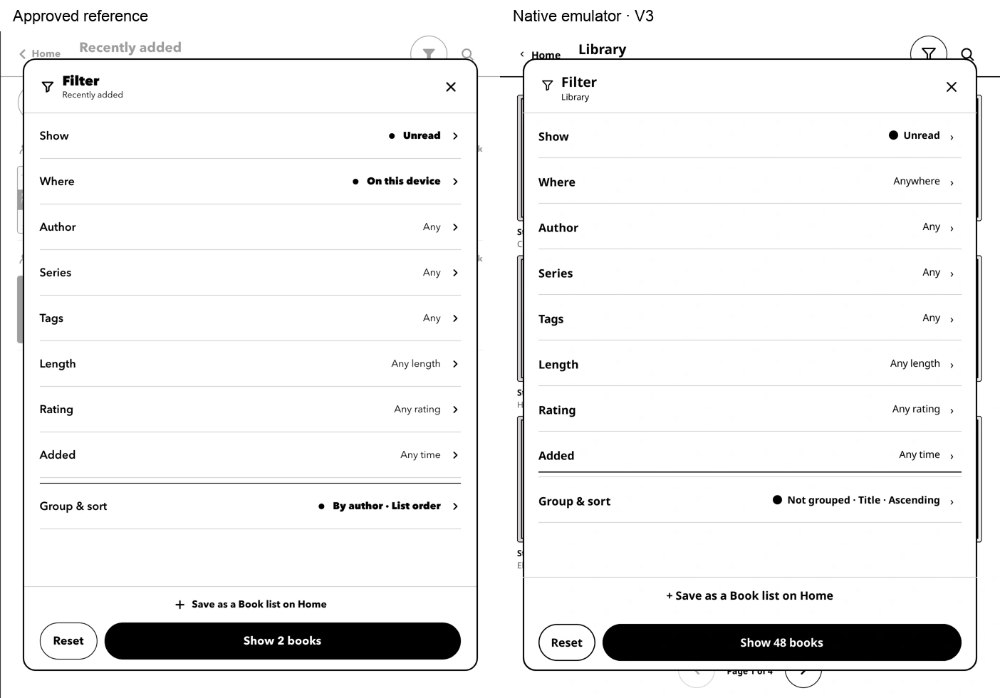

## filter-show

Choice-sheet variant; left is the approved parent-sheet component reference, as no dedicated approved Show picker crop was supplied.

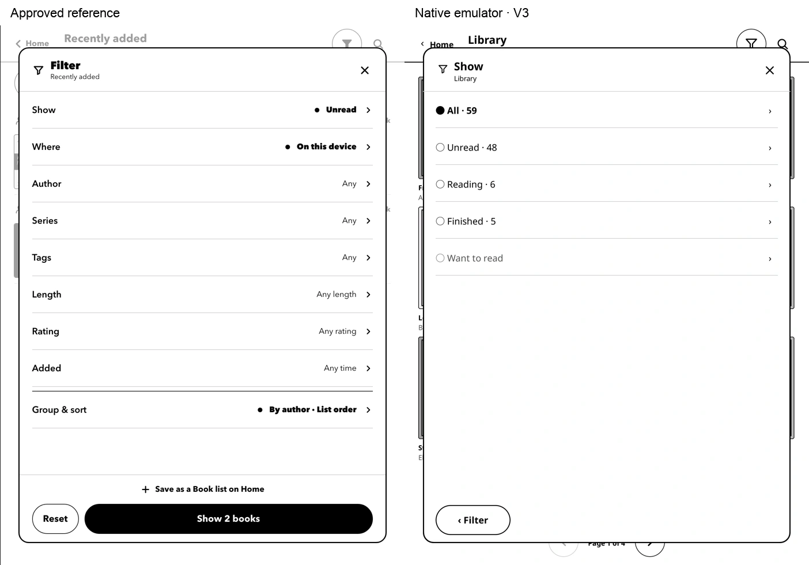

## filter-sort

Group/sort choice-sheet variant; left is the approved parent-sheet component reference.

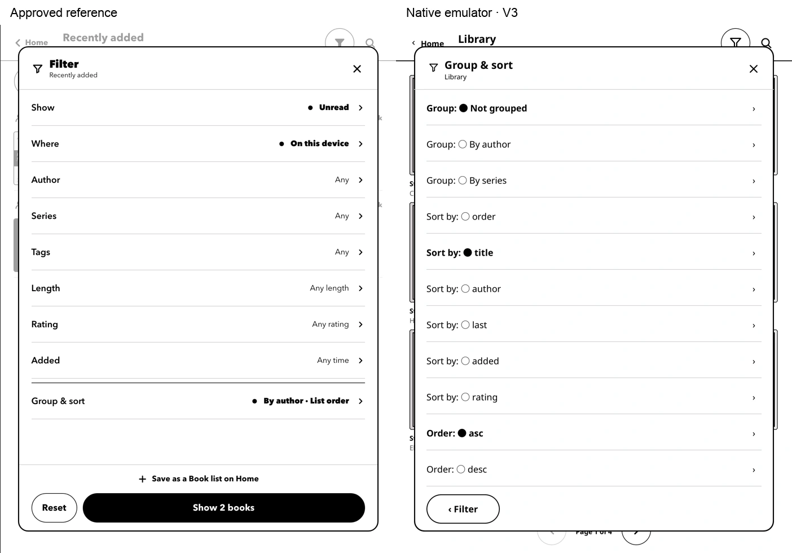

## library-by-author

Cover shelves, author headings, count column and removable group chip. Variable-size bounded group pages show an accurate page number without guessing a total page count.

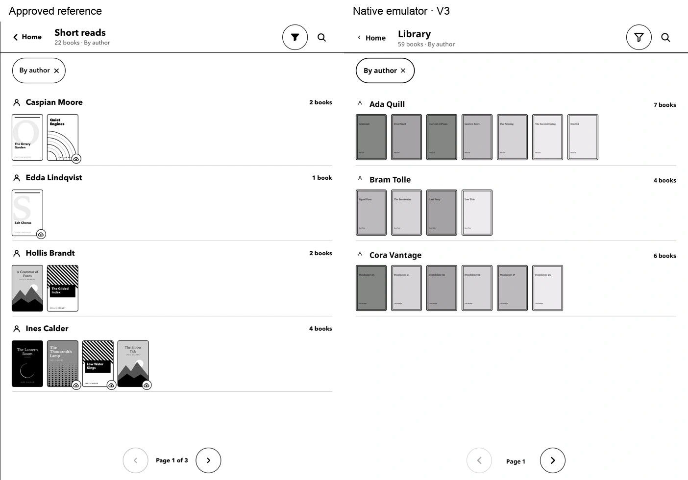

## library-by-series

Cover shelves and segmented series state. Fixture group membership and progress differ; unassigned books keep their own drill-down.

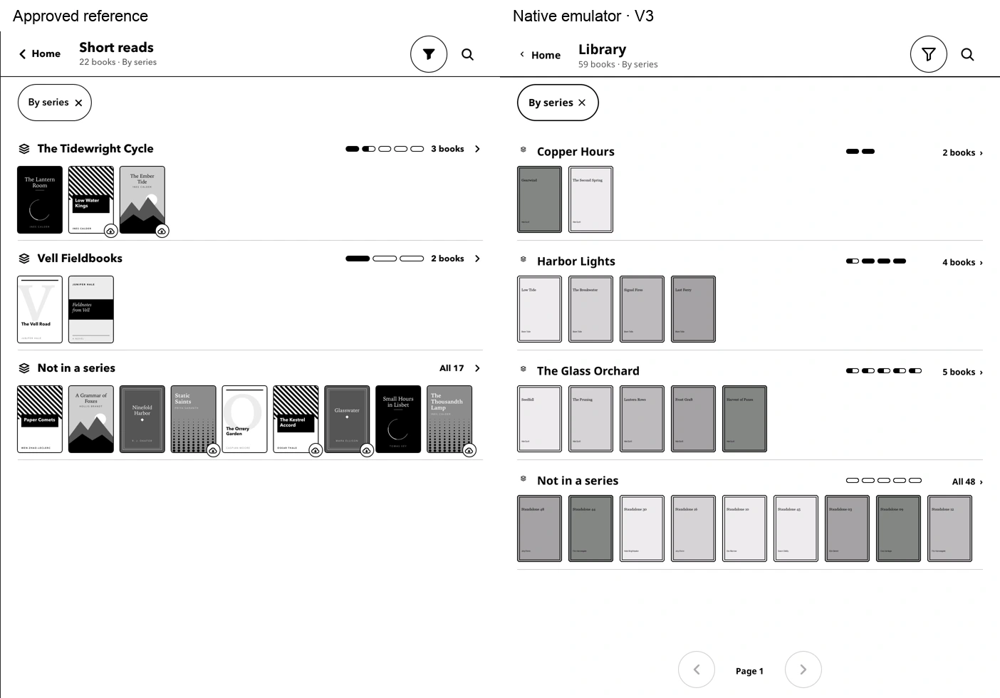

## series

Companion-backed Series capture. All fixture members are on device, so its offline card has no remote candidates.

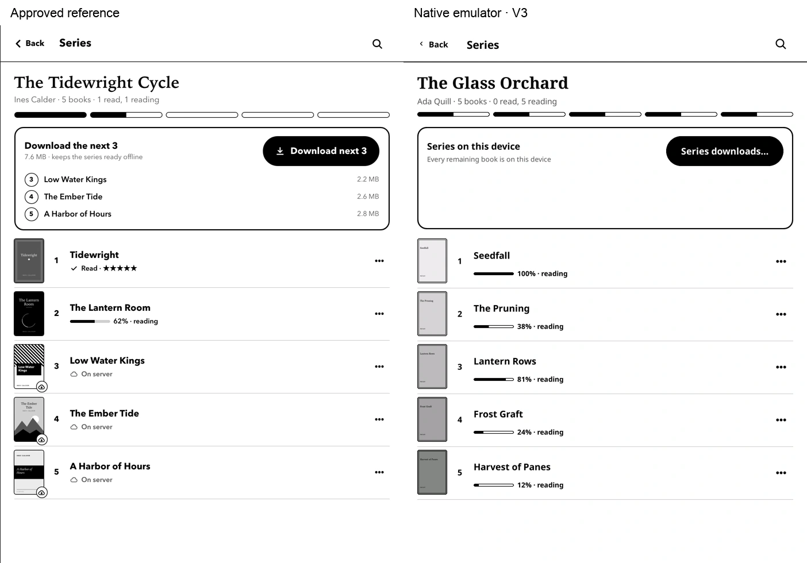

## series-next-three

Extra mixed local/server specimen uses one bounded cached adapter response through the real renderer. Candidate selection semantics are companion-owned. Sizes are omitted because the projection does not publish them.

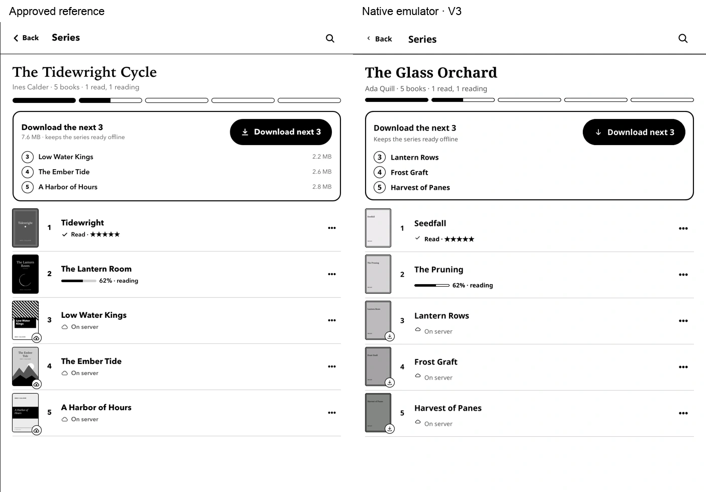

## storage

Actual emulator capacity and eligible actions. Rows with no eligible files are omitted by the worker; no fake cleanup quantities are shown.

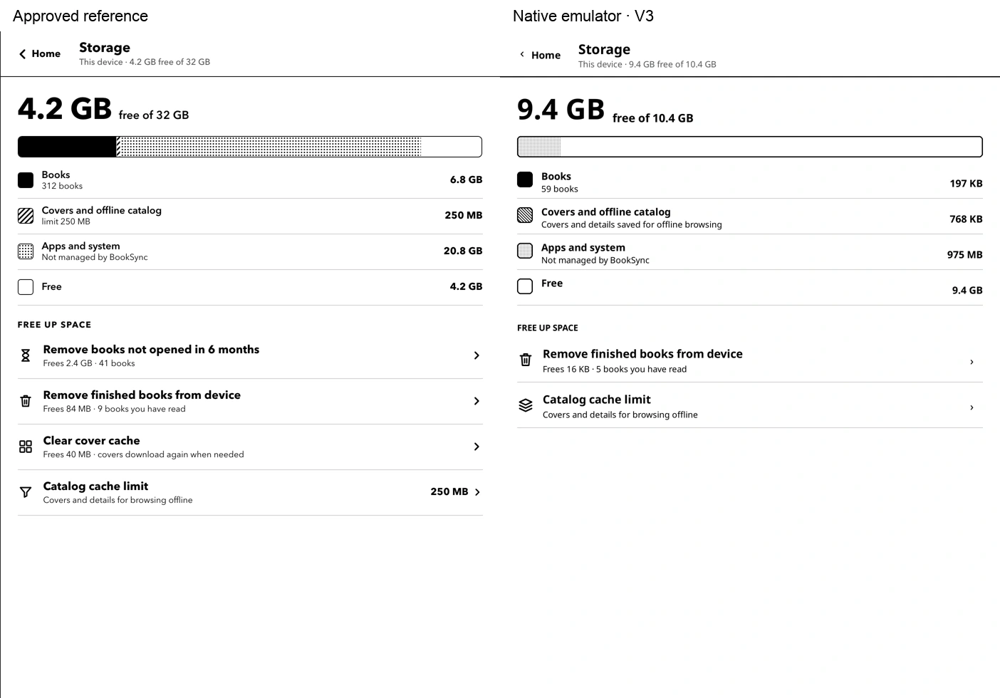

## end-of-book

Manual unmarked finish state; the native Mark action stays available. Saved covers are joined in one bounded worker batch. Metrics use the saved local reading history; unavailable or unfinished measurements remain dashes.

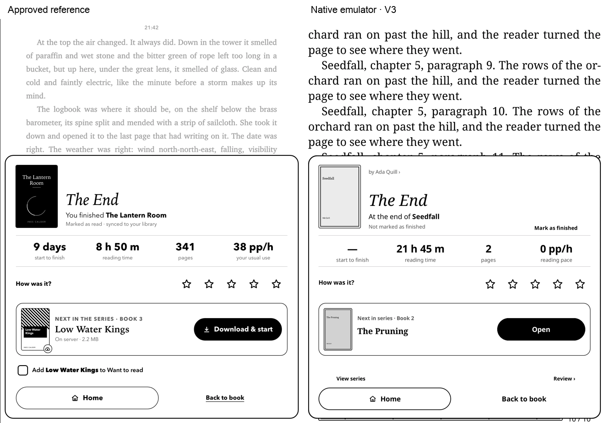

## end-rated

Native local four-star rating. View series and Review preserve existing actions. Want-to-read membership writes are not exposed by the current finish model, so no non-working checkbox is added.

## end-reopened

Reopening retains the rating. Tap outside cancels the pending refresh and never reopens a closed sheet.

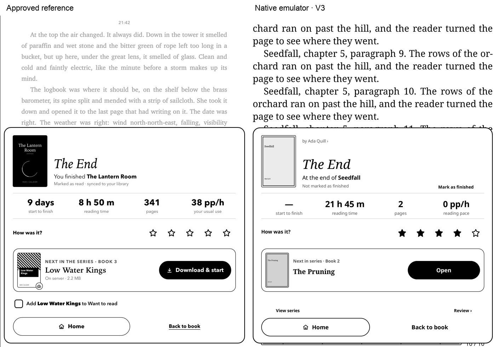

